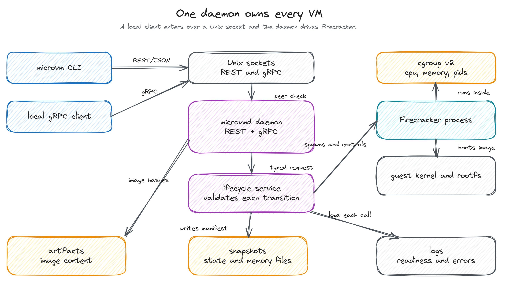
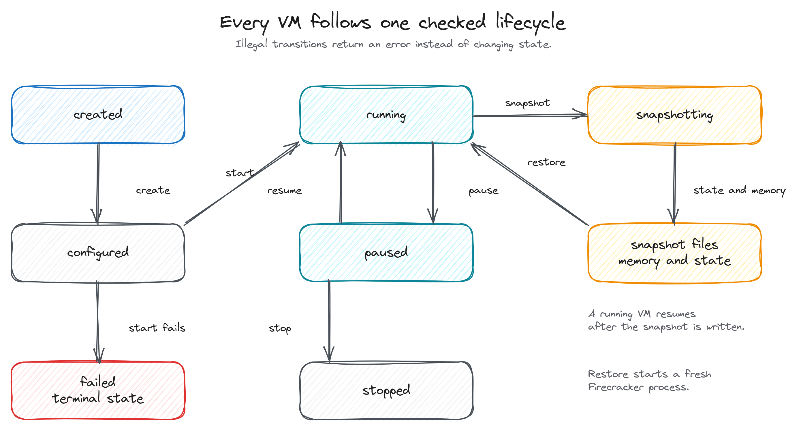

# kvm-microvm

A local control plane for Firecracker microVMs: `microvmd` serves a REST/JSON
and a gRPC API over Unix sockets, and `microvm` drives it from a terminal.

The daemon owns one guest image, the VM lifecycle, and the cgroup, snapshot,
artifact, log, and chroot directories you configure. It opens no TCP listener.
The CLI is a REST client for the daemon.

## What you need

- x86_64 Linux with readable and writable `/dev/kvm`, plus cgroup v2 mounted at
  `/sys/fs/cgroup`.
- Firecracker and jailer 1.16.1. The development scripts reuse a pinned copy
  under `.work/` and download it when missing.
- A Rust toolchain. `cargo build --release` writes `target/release/microvmd` and
  `target/release/microvm`.
- Network access on the first guest image build: `scripts/build-guest-image.sh`
  fetches a pinned guest kernel and a static busybox.
- A systemd login session with user cgroup delegation. The development path uses
  that delegation and needs no sudo.

## Quick start

Build the guest image, build the binaries, then serve the daemon on `.work`
paths. The last command blocks in the foreground until you press Ctrl-C.

```bash
bash scripts/build-guest-image.sh
cargo build --release
bash scripts/dev-run.sh
```

`dev-run.sh` writes `.work/config/microvmd.toml`, creates a delegated cgroup
wrapper under your user session, prints the REST and gRPC socket paths, and runs
`microvmd --config .work/config/microvmd.toml`. Leave it running.

In a second terminal, create and start a no-network VM. The create and restore
commands print the id they create, so the next command can read it back:

```bash
MV="target/release/microvm --socket .work/run/rest.sock"
VM_ID=$($MV create --vcpu 1 --memory-mib 128 --disk-mib 64 --network-policy none | awk '{print $3}')
$MV start --vm-id "$VM_ID"
$MV status --vm-id "$VM_ID"
$MV metrics --vm-id "$VM_ID"
```

Create prints `created vm <id>`, start prints `started vm <id>`, and status
prints `key=value` fields. Now snapshot the running VM, restore a fresh VM from
the snapshot, and clean up both:

```bash
SNAP_ID=$($MV snapshot --vm-id "$VM_ID" | awk '{print $3}')
$MV stop --vm-id "$VM_ID"
RESTORED_ID=$($MV restore --snapshot-id "$SNAP_ID" | awk '{print $3}')
$MV status --vm-id "$RESTORED_ID"
$MV list
$MV stop --vm-id "$RESTORED_ID"
$MV delete --vm-id "$VM_ID"
$MV delete --vm-id "$RESTORED_ID"
```

Snapshot prints `created snapshot <id>`, restore prints `restored vm <id>`, and
delete prints `deleted vm <id>`. Stop the daemon with Ctrl-C in the first
terminal. The script removes the sockets, the cgroup wrapper, and the daemon
process.

## How it works



*Figure 1. Every request enters over a local Unix socket. The daemon validates
it, drives one Firecracker process per VM inside a cgroup v2 leaf, and keeps
artifacts, snapshots, and logs on local disk.*

`microvm` sends REST/JSON to `microvmd` over `/run/microvm/rest.sock` by default.
The daemon also serves gRPC on a second Unix socket. Both adapters call one
lifecycle service, so a transition, validation rule, or error code behaves the
same on either protocol. The service checks the transition against the VM state
machine, applies it through the configured backend, and returns a typed error
when the transition is illegal.

The backend is Firecracker (`backend = "firecracker"`) or an explicit in-memory
simulation (`backend = "sim"`) for tests and CLI exploration. The simulation
uses no KVM, cgroup, or filesystem resource and provides no isolation.



*Figure 2. The daemon accepts only legal transitions and records a failed VM.
Restore starts a fresh Firecracker process.*

A VM moves through `created`, `configured`, `running`, `paused`, `snapshotting`,
`stopped`, and `failed`. A no-network VM signals readiness on its serial console
with the marker `MICROVM_READY`, and the daemon waits for that marker before it
reports the VM as running.

Snapshot create pauses the VM, writes the guest memory file and the VM state
file, and records a local manifest with SHA-256 content hashes. Restore checks
that manifest against the current host and caller, then loads the memory and
state into a fresh Firecracker process.

## Commands

| Command | Action |
| --- | --- |
| `microvm create --vcpu N --memory-mib N --disk-mib N --network-policy P` | Creates a VM record in `created` state. Policies are `none`, `nat-only`, and `egress-allowed`. |
| `microvm start --vm-id ID` | Starts or resumes a VM. |
| `microvm status --vm-id ID` | Prints the state and spec as `key=value` fields. |
| `microvm metrics --vm-id ID` | Reports cgroup v2 metrics with availability flags. |
| `microvm stop --vm-id ID` | Stops a running or paused VM. |
| `microvm snapshot --vm-id ID` | Writes a local snapshot and prints the snapshot id. |
| `microvm restore --snapshot-id ID` | Starts a fresh VM from a snapshot. |
| `microvm list` | Prints one line per VM with id, state, vcpu, and memory. |
| `microvm delete --vm-id ID` | Deletes a stopped or failed VM record. |
| `microvm run --vcpu N --memory-mib N --disk-mib N --network-policy P` | Creates and starts a VM in one call. |

`--socket PATH` is a global flag and sets the REST socket path. The default is
`/run/microvm/rest.sock`. `--json` is a global flag that prints JSON instead of
text.

## Config

`microvmd` reads one TOML file. Validate it without serving:

```bash
target/release/microvmd --config /etc/microvmd.toml --check
```

A complete configuration looks like this:

```toml
backend = "firecracker" # firecracker | sim

[server]
rest_socket = "/run/microvm/rest.sock"
grpc_socket = "/run/microvm/grpc.sock"
socket_mode = "0600"
socket_uid = 1000
socket_gid = 1000
allowed_uids = [1000]
tenant = "local"
role = "owner"

[image]
kernel = "guest/vmlinux"
rootfs = "guest/rootfs.ext4"
boot_args = "console=ttyS0 reboot=k panic=1 pci=off init=/init"

[paths]
state_dir = "/var/lib/microvm"
artifact_dir = "/var/lib/microvm/artifacts"
snapshot_dir = "/var/lib/microvm/snapshots"
socket_dir = "/run/microvm/sockets"
chroot_dir = "/srv/jailer"
log_dir = "/var/log/microvm"

[runtime]
firecracker = "/usr/bin/firecracker"
jailer = "/usr/bin/jailer"
firecracker_version = "1.16.1"
readiness = "auto" # auto | serial | tcp
readiness_marker = "MICROVM_READY"
readiness_port = 8080
socket_timeout_ms = 10000
readiness_timeout_ms = 30000
use_jailer = true

[isolation]
cgroup_root = "/sys/fs/cgroup"
jailer_uid = 10000
jailer_gid = 10000
pids_max = 256
```

A relative `kernel` or `rootfs` path resolves against the config file's
directory. The development config in `.work/config/microvmd.toml` sets
`readiness = "serial"`, `use_jailer = false`, and paths under `.work/`.

## Snapshot behavior and limits

Snapshot create asks Firecracker for a memory file with `mem_file_path` and a
VM state file, then writes a local manifest that records SHA-256 hashes and the
host envelope: VM spec, CPU and KVM API version, cgroup version, Firecracker
version, and owner. Restore validates the manifest against the current host and
caller before it spawns anything. A mismatch is a hard rejection. The manifest
and both files stay on the local host.

The limits are deliberate for this version:

- One guest image per daemon. The kernel and rootfs paths are fixed at startup.
- Snapshots and restore work for `--network-policy none` only. Networked VMs are
  supported by the backend but remain experimental, and the daemon rejects a
  snapshot request for them.
- x86_64 Linux with KVM and cgroup v2 only.
- Unix sockets only, so only local processes can connect.
- No remote registry or tag pulls. The guest image comes from local paths.
- No cross-host snapshot transfer, signing, or encryption.
- One configured principal (`allowed_uids`, `tenant`, and `role`). There is no
  multi-tenancy.
- VM records live in memory. A daemon restart loses them.
- This is a lab tool with no production-readiness claim.

## Testing

The deterministic suite runs without KVM or host privileges:

```bash
cargo test --workspace
```

It covers the lifecycle rules, the REST and gRPC contracts, the snapshot
manifest checks, the metrics records, and a daemon end-to-end test against the
simulation backend.

The real KVM acceptance path runs a no-network VM through create, start, serial
readiness, metrics, snapshot, stop, restore, list, and delete. It needs
`/dev/kvm`, the release binaries, and the guest image:

```bash
cargo build --release
bash scripts/build-guest-image.sh
bash scripts/e2e-firecracker.sh
```

The script starts its own daemon and refuses to run while another `microvmd` is
serving. It checks that no Firecracker process or cgroup leaf is left behind. The
acceptance path uses Firecracker 1.16.1. To check only the configuration and the
dev paths without starting a daemon, run `bash scripts/dev-run.sh --check`.
