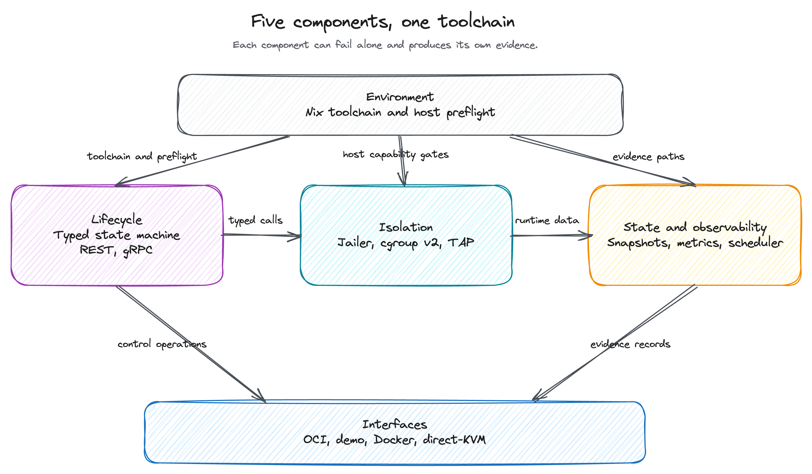
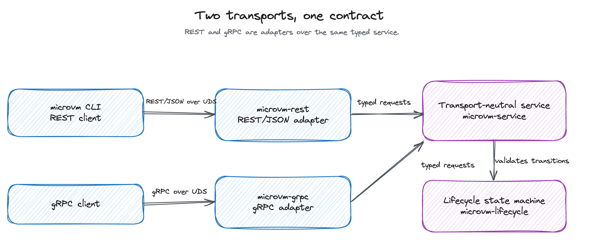
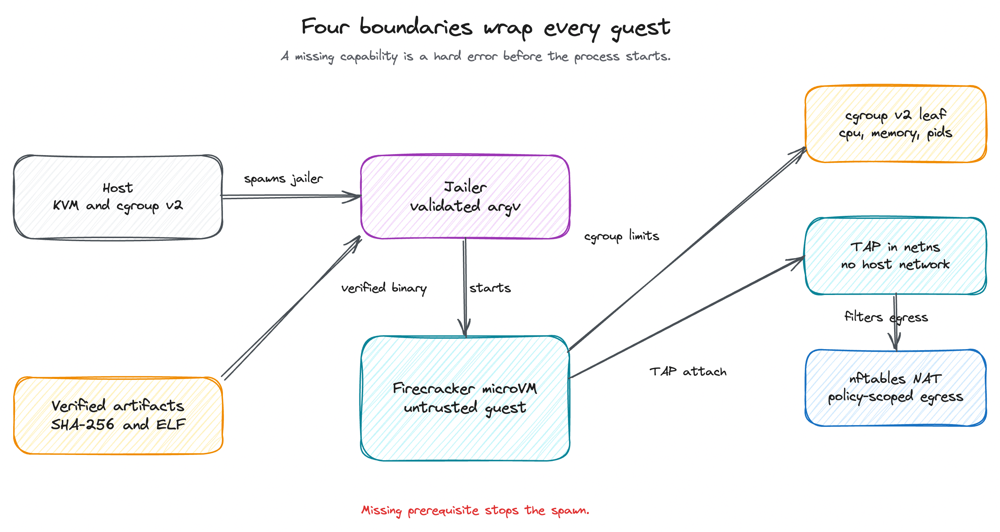
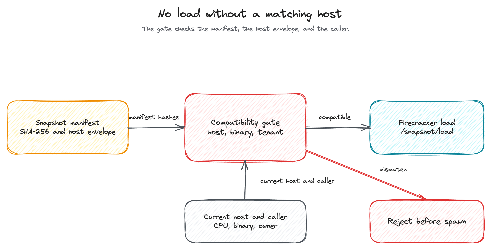

# Architecture

This page describes the component topology, the transport model, the isolation
model, and the state, observability, and interface layers of
kvm-microvm-orchestrator.

The figures are hand-drawn Excalidraw scenes. Regenerate the scenes with
`python3 -B docs/figures/generate.py` and render them as described in
[figures/README.md](figures/README.md).

For the decisions behind each boundary, see [adr/](adr/README.md). For the
trust model and explicit non-claims, see [security.md](security.md).

## 1. Component topology

The platform has five components. Each can succeed or fail alone and carries
its own evidence artifact. The environment provides the toolchain and host
gates. The lifecycle component drives isolation, state records what isolation
reports, and the interfaces component packages the operator-facing paths.

*Figure 1. The environment gates three components; lifecycle and state feed the
interface layer.*

| Component | Outcome it owns | Key crates |
| --- | --- | --- |
| environment | A reproducible devenv/Nix toolchain and a Linux host preflight. | `devenv.nix`, `devenv.yaml`, `scripts/preflight.sh` |
| lifecycle | A typed VM control plane for create, start, stop, snapshot, and restore over the selected transport. | `microvm-types`, `microvm-errors`, `microvm-lifecycle`, `microvm-transport-contract`, `microvm-service`, `microvm-rest`, `microvm-grpc`, `microvm-cli` |
| isolation | Per-VM jailer, cgroup v2 limits, TAP/NAT, and cleanup enforce host boundaries. | `microvm-isolation`, `microvm-firecracker` |
| state-observability | Snapshot and restore, resource metrics, and core-aware placement are auditable. | `microvm-snapshots`, `microvm-metrics`, `microvm-scheduler`, `microvm-artifacts` |
| interfaces-benchmarks | The OCI entry point, Docker comparison, warm-function demo, and direct-KVM subset produce reproducible artifacts. | `microvm-oci`, `microvm-bench`, `microvm-demo`, `microvm-backend-directkvm` |

Two verification crates cross the five components:
`microvm-contract-tests` checks REST/gRPC parity, socket hardening, and request
audit; `microvm-security-tests` runs the adversarial boundary batteries.

### Workspace crate map

| Crate | Role |
| --- | --- |
| `microvm-types` | Typed IDs for VMs, snapshots, and tenants, plus resource specs and VM states. |
| `microvm-errors` | Typed error model with a stable `ErrorCode` vocabulary. |
| `microvm-lifecycle` | VM lifecycle state machine and legal transitions. |
| `microvm-transport-contract` | Transport-neutral service contract shared by REST and gRPC. |
| `microvm-service` | Transport-neutral lifecycle service implementation. |
| `microvm-rest` | REST/JSON adapter over a Unix domain socket. |
| `microvm-grpc` | gRPC adapter over a Unix domain socket. |
| `microvm-cli` | `microvm` command-line client, Unix-socket only. |
| `microvm-artifacts` | Digest-addressed local artifact store and path validation. |
| `microvm-oci` | Constrained local OCI-like importer. |
| `microvm-isolation` | cgroup-v2 hierarchy, jailer argv, TAP/netns/nftables, cleanup, and binary verification. |
| `microvm-firecracker` | Firecracker runtime adapter and process supervision. |
| `microvm-snapshots` | Versioned snapshot manifest and pre-restore compatibility gate. |
| `microvm-metrics` | Per-VM host metrics from cgroups and TAP, plus optional guest metrics. |
| `microvm-scheduler` | Deterministic core-aware first-fit-decreasing placement with admission control. |
| `microvm-contract-tests` | REST/gRPC transport parity and socket-hardening contract tests. |
| `microvm-security-tests` | Adversarial boundary tests for paths, auth, cgroups, networks, snapshots, OCI input, and binaries. |
| `microvm-bench` | Reproducible snapshot and boot benchmark harness with a Docker comparison. |
| `microvm-demo` | Warm HTTP-function microVM demo with cold and warm evidence. |
| `microvm-backend-directkvm` | Educational direct-KVM subset behind a Cargo feature. |

## 2. Transport model

REST/JSON and gRPC run over Unix domain sockets and share one
transport-neutral service layer. A REST call and a gRPC call enter different
adapters, then meet the same contract, so a state transition, idempotency rule,
or ownership check behaves the same on both.

*Figure 2. The CLI and REST clients reach `microvm-rest`; gRPC clients reach
`microvm-grpc`; both adapters call `microvm-service`.*

- The CLI `--socket` default is `/run/microvm/api/rest.sock`. The gRPC service
  is documented at `unix:///run/microvm/api.sock`. See
  [`api/microvm/v1/service.proto`](../api/microvm/v1/service.proto) and
  [`api/openapi.yaml`](../api/openapi.yaml).
- The socket file is created with a protective mode and owner. The platform
  rejects a world-writable control socket.
- The owner principal comes from Unix socket peer credentials combined with the
  filesystem mode and ownership of the socket path. See
  [security.md](security.md#3-authentication) and
  [ADR-0004](adr/0004-peer-credential-auth.md).
- No TCP listener exists in the platform. Contract tests enforce that absence.
  See [ADR-0001](adr/0001-unix-socket-only-transport.md).

### Lifecycle operations

`CreateVm`, `StartVm`, `StopVm`, `SnapshotVm`, `RestoreVm`, `GetVmStatus`, and
`GetVmMetrics` operate on a typed state machine. VM states are `created`,
`configured`, `running`, `paused`, `snapshotting`, `restoring`, `stopped`, and
`failed`. The state machine validates each transition, and an illegal
transition returns a typed error.

## 3. Isolation model

Isolation fails closed. A missing capability, invalid path, unsupported cgroup
topology, or unverified artifact is a hard error before any process spawn. See
[ADR-0012](adr/0012-fail-closed-tcb.md).

*Figure 3. The jailer, cgroup leaf, network namespace, and nftables policy each
constrain the guest before and during execution.*

### 3.1 cgroup-v2

The platform builds a unified cgroup-v2 hierarchy explicitly and hands the
jailer a pre-created leaf path. It does not rely on jailer defaults.

- One parent cgroup (`<root>/microvm`) delegates `cpu`, `memory`, `pids`, and
  `io` through `cgroup.subtree_control`.
- One leaf cgroup per VM (`<root>/microvm/<vm-id>`) carries explicit limits:
  `cpu.max`, `memory.max`, `memory.swap.max`, `pids.max`, and optional `io.max`.
  A leaf has no children and an empty `cgroup.subtree_control`.
- The generated jailer argv includes `--cgroup-version=2` and a
  `--parent-cgroup` that points at the pre-created leaf.
- A missing cgroup root or required controller returns `CgroupUnavailable`
  before any spawn. An invalid spec or leaf-contract violation returns
  `InvalidResourceSpec`.

See [ADR-0005](adr/0005-explicit-cgroup-v2.md), the
[preflight runbook](runbooks/preflight.md), and the
[cleanup runbook](runbooks/cleanup.md).

### 3.2 Firecracker + jailer

- The runtime adapter uses a pinned Firecracker release and a static binary. See
  [ADR-0002](adr/0002-firecracker-first.md).
- The Firecracker and jailer binaries are verified by SHA-256, ELF form, and
  seccomp mode before use. The platform owns this validation rather than
  treating release-build seccomp or trusted jailer paths as sufficient outer
  security.
- Jailer arguments are validated. Unrestricted argument passthrough is rejected.
- Readiness signaling and process supervision fail closed. A missing
  prerequisite stops startup instead of falling back.

### 3.3 Networking (TAP + netns + nftables)

- Each VM gets a TAP device inside an isolated network namespace.
- Controlled nftables NAT provides egress. Guest egress is enabled only by the
  VM network policy: `none`, `nat-only`, or `egress-allowed`.
- Inter-VM traffic and unsolicited inbound traffic are denied.
- Network setup is idempotent, and teardown is deterministic.

See [ADR-0006](adr/0006-per-vm-tap-netns-nat.md) and the
[network runbook](runbooks/network.md).

### 3.4 Cleanup and reconciliation

Cleanup is idempotent and leaves no owned resource behind. An orphan reconciler
detects leaked cgroups, netns, nft tables, and processes, quarantines them, and
produces leak records. See the [cleanup runbook](runbooks/cleanup.md).

## 4. State and observability

### 4.1 Snapshots

A snapshot has a versioned, local, content-addressed manifest. The manifest
records SHA-256 content hashes for the Firecracker binary, kernel, rootfs, block
devices, guest memory, and VM state. It also records compatibility metadata:
VM config, CPU and KVM API version, cgroup version, owner tenant, quota, and the
immutable-memory requirement. The serialized form is
[`schemas/snapshot-manifest.v1.json`](../schemas/snapshot-manifest.v1.json).

*Figure 4. The compatibility gate checks the manifest, the current host
envelope, and the caller before Firecracker loads the snapshot.*

The pre-restore gate validates the manifest against the current host, binary,
config, and caller tenant before it spawns a Firecracker process or issues
`/snapshot/load`. A host-envelope mismatch is a hard rejection. The SHA-256
digests are the orchestrator's own content hashes. Firecracker's internal
snapshot CRC detects accidental corruption and is not treated as
authentication.

Snapshots stay on the host. The repository defines no cross-host transfer,
signing, or encryption contract. See
[ADR-0007](adr/0007-local-content-addressed-snapshots.md) and the
[snapshot runbook](runbooks/snapshot.md).

### 4.2 Metrics

Per-VM metrics carry an availability flag and a stable schema
([`schemas/vm-metrics-record.v1.json`](../schemas/vm-metrics-record.v1.json)):

- Host cgroup v2: CPU usage and throttling, memory current and events, block
  I/O, and pids.
- TAP network: RX and TX byte counters plus derived throughput.
- Boot and restore phases: host-monotonic spans with derived durations.
- Optional guest agent: guest CPU steal, load, and RSS when the agent is
  reachable.

Missing data is recorded as `Unavailable` with a bounded reason. A missing
guest agent or removed cgroup is reported as unavailable, not as a measured
zero.

### 4.3 Scheduler

The scheduler is a pure, deterministic decision engine. It performs no I/O and
does not touch cgroups, TAP devices, or Firecracker. It decides where a VM's
reserved resources land: which NUMA node or flat CPU pool, and which logical
CPUs.

- First-fit-decreasing handles batches. First-fit handles single requests.
- Per-tenant quota admission control runs before placement.
- A bin accepts a request only when it has enough free CPUs and free memory.
  A no-fit decision returns a typed `Unschedulable` reason.
- Identical input yields identical placement. Bins are ordered, CPUs are chosen
  lowest-id first, and the FFD sort key is total. There is no randomness and no
  clock dependency.
- NUMA awareness is opt-in and evidence-backed. With no NUMA topology, the host
  is one flat bin and the scheduler makes no NUMA claim.

## 5. Interfaces and benchmarks

### 5.1 Constrained local OCI-like import

`microvm run` imports a constrained local OCI-like layout: `manifest.json` plus
`blobs/sha256/<hex>`. It verifies the SHA-256 of the config blob and every
layer, selects a supported platform (`linux/amd64` or `linux/arm64`), and
translates the result into a typed microVM spec.

- The reference must be a local path or a `file://` URI. Remote and tag-only
  references such as `https://`, `docker://`, `oci://`, `registry://`,
  `repo/img@sha256:...`, and `nginx:latest` are rejected before any I/O with
  `local_artifact_required`.
- The importer refuses images that request host mounts, host network, PID or IPC
  sharing, privileged mode, capability additions, or arbitrary host process
  controls. Container process metadata (Cmd, Entrypoint, Env) is ignored and
  never applied to the host.
- The importer is not an OCI runtime and makes no OCI runtime conformance claim.

See [ADR-0008](adr/0008-local-digest-artifacts-constrained-oci.md).

### 5.2 Benchmarks and demo

The benchmark harness (`microvm-bench`) publishes distributions: p50, p95, and
p99 under cold and warm page-cache conditions. `target_ms` is metadata, and the
schema has no `pass` field. See
[setup.md](setup.md#benchmark-interpretation).

The warm HTTP-function demo (`microvm-demo`) records cold first-call and warm
pool behavior with reproducible evidence. It does not gate a release.

### 5.3 Direct-KVM educational subset

`microvm-backend-directkvm` is an educational KVM backend behind the
`direct-kvm` Cargo feature, off by default. It is not a production Firecracker
replacement. The contract is pinned in
[design/direct-kvm-subset.md](design/direct-kvm-subset.md): x86_64 only, one
vCPU, one 16 MiB memory slot, serial output, and four handled VM exits:
`KVM_EXIT_IO` on port `0x3F8`, `KVM_EXIT_HLT`, `KVM_EXIT_FAIL_ENTRY`, and
`KVM_EXIT_INTERNAL_ERROR`. Any other exit becomes `Failed`. Multi-vCPU,
networking, block devices, vsock, migration, snapshot/restore, and other
architectures are out of scope.

See [ADR-0010](adr/0010-direct-kvm-educational-subset.md).

## 6. Determinism boundary

Specification, validation, and decision logic are pure. Host I/O sits behind a
thin, injectable shell.

- Snapshot manifest checks, cgroup spec validation, jailer argv generation,
  scheduler placement, OCI reference classification, and the direct-KVM contract
  are pure functions that need no host access.
- Real `/dev/kvm`, `/dev/net/tun`, and writable-cgroupfs runs live behind the
  `privileged` feature and produce `blocked` evidence when prerequisites are
  absent.

This split lets the deterministic lane run without host capabilities while
privileged claims still require real evidence. See
[ADR-0009](adr/0009-hybrid-test-lanes.md).
