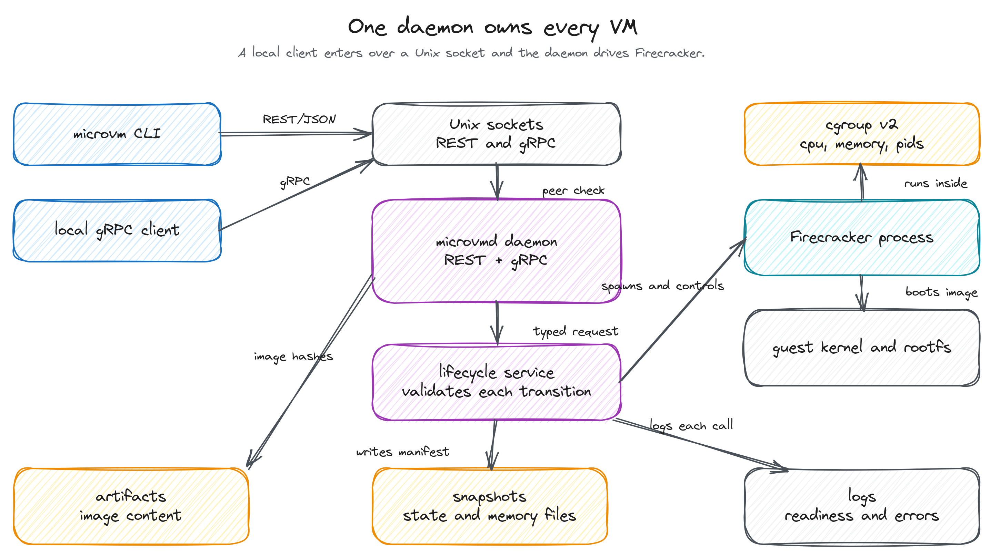
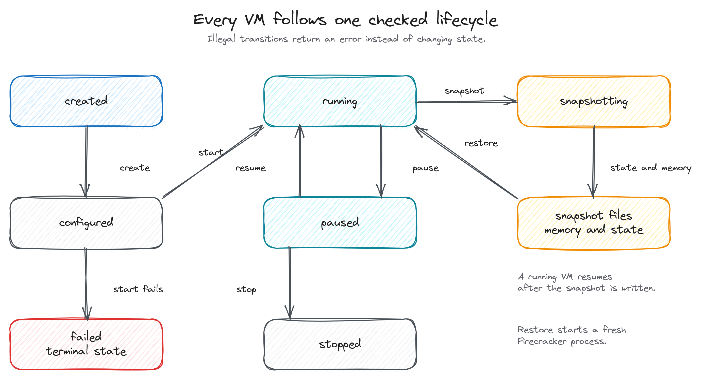
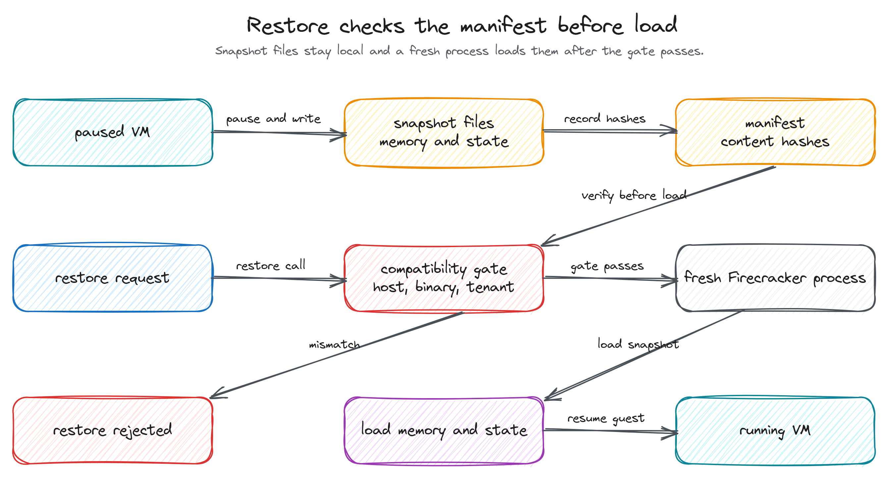

# Architecture

`microvmd` is one local process. It owns one guest image and the VMs created from
it. `microvm` is a REST client. The daemon serves REST/JSON and gRPC on two Unix
domain sockets and opens no TCP listener.

## Request path

*Figure 1. Both protocols enter one lifecycle service, which drives Firecracker
under cgroup v2 and keeps state on local disk.*

A request arrives on the REST socket or the gRPC socket. The daemon checks the
peer UID against `server.allowed_uids`, and the socket file mode and owner guard
the filesystem side. Both adapters decode the request into the same typed call
and pass it to the lifecycle service. The service validates the call against the
VM state machine, applies it through the backend, and returns a typed error when
the transition or the input is invalid. [Security](security.md) describes the
trust model.

The Firecracker backend prepares a cgroup v2 leaf, starts one Firecracker process
per VM, and supervises it. The simulation backend (`backend = "sim"`) keeps VM
records in memory and touches no host resource. Tests use it, and it provides no
isolation.

## VM lifecycle

*Figure 2. The daemon accepts legal transitions only. Restore starts a fresh
Firecracker process.*

A VM is in one of `created`, `configured`, `running`, `paused`, `snapshotting`,
`stopped`, or `failed`. The state machine rejects every other transition with a
typed error and leaves the VM alone. A failed start moves the VM to `failed`; the
record stays until you delete it.

`runtime.readiness` decides how a boot is confirmed: `auto`, `serial`, or `tcp`.
A no-network VM uses serial readiness. The guest prints
`runtime.readiness_marker` (`MICROVM_READY` by default) on its serial console,
and the daemon moves the VM to `running` when it reads that marker. The
no-network serial path is the v1 acceptance path.

## Snapshot and restore

*Figure 3. Snapshot files and a content-hashed manifest stay local. Restore
validates the manifest, then loads a fresh process.*

Snapshot create works on a running or paused VM. Firecracker writes guest memory
to `mem_file_path` and device state to a state file. The daemon writes a local
manifest with SHA-256 content hashes and the host envelope: VM spec, CPU and KVM
API version, cgroup version, Firecracker version, and owner.

Restore reads the manifest, checks the content hashes, and compares the envelope
with the current host and caller. A mismatch fails before any process starts. A
match starts a fresh Firecracker process and loads memory through `mem_backend`
and the state file. Snapshots work for `network_policy = none` only. The backend
can run a networked VM, but that path is experimental and a snapshot request for
it is rejected.

## Metrics and local state

Metrics come from cgroup v2: CPU use and throttling, memory current and events,
pids, and block I/O. Each record carries an availability flag. A reading the
cgroup cannot provide is reported as unavailable and never filled with a zero.

The daemon writes logs to `paths.log_dir`, snapshots to `paths.snapshot_dir`,
and imported image artifacts to `paths.artifact_dir`. VM records live in memory
and do not survive a daemon restart. Snapshots and logs do.

## Isolation boundaries

One guest image serves every VM. Each Firecracker process runs inside a cgroup v2
leaf with the VM's cpu and memory limits and the configured `isolation.pids_max`.
A networked VM launches under the jailer when `runtime.use_jailer` is true. The
v1 no-network path launches Firecracker directly and attaches its PID to the
leaf. The daemon reads the guest image from local paths and never opens a TCP
socket.
